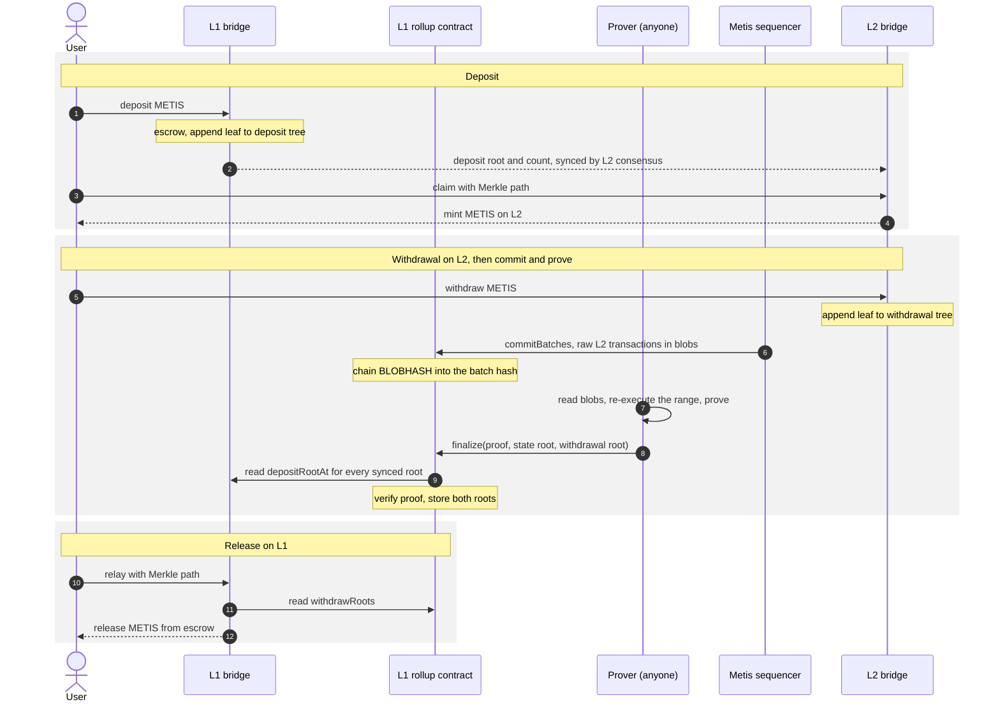

# Metis bridge protocol and cost model

This proposal turns Metis into a validity-proven rollup bridge. Raw L2
transactions are published in Ethereum blobs. L1 records each batch's blob
versioned hash at commit and, once a Ziren proof is verified, the latest L2
state root and the L2 withdrawal tree root. Deposits enter an L1 deposit tree
that L2 syncs and verifies before minting. The [cost model](#cost-model)
compares this design with an assumed current publication cost, and
[optimizations](#optimizations) ranks further savings.

The [output oracle](../contracts/metis-output-oracle/) in this repository
implements the earlier design, which proves batches already appended to Metis's
state commitment chain (SCC). This document supersedes that design. The rollup
contract, bridges, guest and messenger changes below are not yet implemented;
prototype contracts and the guest's blob checks were
[measured](#measurements) outside the repository.

## Overview



The state root and withdrawal root reach L1 only through a verified proof.
Deposit roots reach L2 through the L2 consensus layer, and finalization checks
every synced root against L1.

| Location | State |
| --- | --- |
| Ethereum blobs | Raw L2 transactions of each batch: the data availability |
| L1 rollup contract | Chained batch hash at each commit boundary; per finalized batch, `finalizedStateRoots[i]` and `withdrawRoots[i]`; the last finalized deposit-sync chain |
| L1 bridge | Append-only deposit tree and its root after every deposit; escrow; relayed-withdrawal bitmap |
| L2 bridge | Synced deposit roots, deposit-sync chain and claimed bitmap; append-only withdrawal tree |

The state root is the `l2geth` execution state root of the last block in the
finalized range. Per-block state roots are not published on L1: withdrawals
prove against the withdrawal root, and the next proof starts from the stored
state root.

## Batch commitment

The sequencer publishes each batch in a type-3 transaction that calls
`commitBatches(parentBatchHash, lastBatchHash)`. For every blob `i` carried by
that transaction the contract computes

```text
batchHash = keccak256(0x01 || uint64(batchIndex) || parentBatchHash || BLOBHASH(i))
```

where `0x01` is the batch-format version byte, so a later format cannot produce
the same hash as this one. The contract stores the last hash of each commit,
keyed by its batch index; finalization therefore targets a commit boundary. The
commit is accepted only if the parent equals the latest stored hash and the
computed chain equals `lastBatchHash`. Reading
`BLOBHASH` in the transaction that carries the blob shows that Ethereum
published that data; a hash supplied in calldata would not. One Osaka
transaction can carry at most 6 blobs
([EIP-7594](https://eips.ethereum.org/EIPS/eip-7594)).

This replaces three transactions per batch today: the SCC state-root append,
the inbox reference and the separate blob upload. Metis nodes must derive
batches from the commit transaction's blobs instead of the inbox reference, so
the derivation format changes.

The contract accepts commits only from the sequencer addresses that the L2
consensus layer designates; how they are chosen is out of scope here.
Unfinalized commits may be reverted only by a governance role behind a
timelock, and finalized batches never. Reverting a commit invalidates every
later commit and any proof that covers it.

Metis blobs already use the OP Stack blob encoding (version 0, 127 bytes per 4
field elements), OP channel frames and brotli compression. Each blob holds one
Metis span batch, whose prefix is the first L2 block number
followed by parent and L1-origin checks
([`span_batch.go`](https://github.com/MetisProtocol/mvm/blob/61ef7e9a9a1f404505279e1d86f2c26a885bcc86/go/op-program/client/derive/span_batch.go)).

## Deposits

1. A user deposits on the L1 bridge. The bridge escrows the asset, appends
   `keccak256(abi.encode(l1ChainId, l1Bridge, index, from, l2Recipient,
   amount))` to a depth-32 append-only Merkle tree, and stores the root after
   that deposit as `depositRootAt[index + 1]`.
2. The L2 consensus layer syncs a root and its deposit count to the L2 bridge,
   in increasing count order. The L2 bridge extends
   `depositSyncChain = keccak256(abi.encode(depositSyncChain, count, root))`.
3. Anyone claims a deposit on L2 with its index and Merkle path against a
   synced root. The L2 bridge checks the path, marks the index claimed and
   mints the same amount.
4. Finalization takes the synced counts as calldata and rebuilds the chain from
   the L1 root history. The proof must export the L2 chain value, so every root
   L2 accepted is checked against L1, not only the latest. Checking only the
   latest would let a sequencer sync a false root, mint against it and then
   sync the true root before the range ends.

Because the tree is append-only, a root at count `n` commits to every earlier
deposit, and the claimed bitmap prevents a second mint across roots. This
replaces the canonical transaction chain's enqueue path for deposits. Metis
span batches carry queue-origin (L1) transactions from that path; it will be
redesigned, and the guest's treatment of them is not yet specified. Whatever
replaces it must let the proof authenticate every L1-to-L2 input against L1,
as the sync chain does for deposit roots.

How and when roots are synced, including any deadline or forced-inclusion
rule, belongs to the L2 consensus layer and is out of scope here. This design
only requires that every root L2 accepts is checked against L1 at
finalization.

## Withdrawals

Every L2-to-L1 withdrawal appends
`keccak256(abi.encode(l2ChainId, l2Bridge, index, l2Sender, l1Recipient,
amount))` to a depth-32 append-only tree in the L2 bridge, whose root is kept in
L2 state. The guest exports that root at the end of the proven range, and
finalization stores it as `withdrawRoots[batchIndex]`.

The bridge carries only METIS, so neither leaf has a token field. Each leaf
binds its source chain ID and bridge address, so a leaf cannot be replayed
against another deployment.

To relay, anyone supplies the batch index, the withdrawal fields and its
32-node path. The L1 bridge checks the path at the leaf's own index, which
prevents proving an interior node, marks the index relayed and releases escrow.
Because the tree is cumulative, a withdrawal can be relayed against any stored
withdrawal root at or after the batch that includes it.

## Proof statement and guest

The proof's public values bind:

| Value | Source on L1 |
| --- | --- |
| L2 chain ID, program key | Rollup configuration |
| Previous batch hash and state root | Stored at the last finalized batch |
| Number of batches and new batch hash | Committed batch-hash chain |
| New state root, withdrawal root | Caller; stored on success |
| Previous and new deposit-sync chain | Stored chain, extended from `depositRootAt` |

The verifier checks the proof against the SHA-256 of these values. The guest
must, in order:

1. Recompute the batch-hash chain from the previous batch hash and each blob's
   versioned hash, and check it against the committed hash.
2. Authenticate each blob: check `0x01 || sha256(commitment)[1:]` equals the
   versioned hash, then verify the blob's KZG proof. The host computes the
   commitment and proof with c-kzg, because the beacon blob API no longer
   serves proofs after Fusaka. Reject non-canonical field elements, a
   duplicated or reordered hash and a short or trailing payload.
3. Decode the blob, frames, channel and span batch, and reproduce Metis
   derivation and `l2geth` execution exactly from the previous state root.
   The derived ending block must equal the committed range.
4. Execute deposit syncs and claims as ordinary L2 transactions, and export the
   final `depositSyncChain` and withdrawal root read from L2 state.

Steps 2 and 3 derive the blob hash and the state root from the same bytes. The
sequencer encodes a batch's raw transactions into blobs and executes the same
transactions in the EVM to produce the state root; the guest repeats both from
one input inside one proof, so neither result can change without the other.
Every executed transaction and its block structure (boundaries, timestamps and
L1 origins) must come from the blob, and every decoded transaction must be
executed. The guest decodes the published bytes rather than re-encoding the
transactions: brotli output is not unique, so a re-encoded blob would match
the committed hash only with the sequencer's exact compressor version and
settings, and decompression is the cheaper direction. Re-encoding is sound
only with a pinned, deterministic encoder.

Pin the deployed Andromeda node release, fork rules and decoding first. The
repository's [Go fault-proof program](https://github.com/MetisProtocol/mvm/blob/61ef7e9a9a1f404505279e1d86f2c26a885bcc86/go/op-program/client/program.go)
is candidate code. Its [oracle client](https://github.com/MetisProtocol/mvm/blob/61ef7e9a9a1f404505279e1d86f2c26a885bcc86/go/op-preimage/oracle.go)
returns bytes unchecked, and its host-side
[`WithVerification`](https://github.com/MetisProtocol/mvm/blob/61ef7e9a9a1f404505279e1d86f2c26a885bcc86/go/op-preimage/verifier.go)
passes blob field elements through unverified. Proved execution must check
every preimage, trie witness and blob. Mainnet use of this program has not been
established; differential replay against the pinned production node on real
batches must match every state root. Reconcile its configuration's
`L1ChainId=1088` with Ethereum chain ID 1 before porting it.

### Blob authentication choice

Production rollups bind blob contents in one of three ways
(research date 2026-10-28):

| Family | Projects | L1 cost per proof |
| --- | --- | --- |
| Circuit evaluates the blob at a hash-derived point; L1 calls the point-evaluation precompile per blob | Scroll v1 to v6, zkSync Era, Linea, Starknet | 50,000 gas per blob |
| Guest or circuit verifies the KZG opening itself | Scroll v7, Taiko, ZKsync OS, OP Succinct, Kailua | None |
| Batched equivalence, one precompile call per proof | Aztec | 50,000 gas |

None recomputes the full commitment in a zkVM in production. Use the second
family: per-blob precompile calls would consume the verifier's remaining gas
under the transaction cap as batches accumulate. Ziren provides BLS12-381 G1
add/double/decompress and Fp/Fp2 syscalls but no pairing chip; the patched
[`kzg-rs`](https://github.com/ziren-patches/kzg-rs/tree/35725e54518a1b56ec908d12e77f3fc9891f643d)
and [`bls12_381`](https://github.com/ziren-patches/bls12_381/tree/1bee78db02337751d5334437c1bb3fe244e283d7)
build the pairing from those. The `bls12_381` patch takes `zkm-lib` from Ziren
without a revision; lock it to the approved Ziren revision. With aggregation,
range proofs can commit each blob's opening and the aggregation guest can verify
all of them with one batched pairing check.

## Ziren integration

Ziren produces the shrink proof of the authenticated Metis state transition.
[Ziren #568](https://github.com/ProjectZKM/Ziren/pull/568) supplies the shrinker;
OPSuccinct owns the [exporter](../crates/ziren-shrink-export/) and
[Solidity verifier](../contracts/ziren-shrink-verifier/). The compact shrink is
terminal and commits the root digest, covering the application key, the
committed-value digest, the exit code and the recursion root. The rollup calls
the verifier through `verify(bytes proofPacket, bytes32 expectedOutputDigest)`.

The recorded verification transaction used **13,668,039 gas**, including its
182 KB packet's 2,834,640 calldata gas, for an Ethereum-block guest on a local
Osaka node enforcing the 16,777,216-gas transaction cap. Deployment of all
modules used 141,599,268 gas. Proof geometry does not grow with the number of
batches for a fixed shrink profile; rerun the measurement for every approved
build and the real Metis guest.

## Demand-driven finalization

Commits continue with every batch; finalization need not. If no withdrawal or
other consumer needs newer finalized state, proving and verification may wait.
Waiting never finalizes a batch. When a withdrawal needs batch `K`, one proof
can finalize every committed batch from the last finalized batch through `K`,
where `K` is a commit boundary, because the contract checks only the two
chained hashes at the range ends. There is no per-proof batch limit on L1;
proving capacity and guest memory bound the range instead.

Finalization is permissionless: anyone may submit a valid proof, generated by
their own prover or by a delegated proving service. A withdrawing user, the
operator or a relayer can therefore finalize the batch they need without
waiting for anyone else. The public values do not name the submitter, so a
delegated prover's proof can be submitted from any address. Concurrent
submissions race: the first valid one wins, and a later proof that starts from
the replaced finalized batch reverts, wasting its gas. If finalization is ever
rewarded, bind the submitter in the public values so that a pending proof
cannot be copied.

Anyone proving must be able to obtain the inputs. Publish the guest, its program
key and the prover tooling, and keep blob data with each blob's commitment
available beyond Ethereum's retention of about 18 days. The
[catch-up costs](#demand-driven-catch-up) cover idle periods. The current SCC
oracle in this repository still accepts at most 64 batches per proof.

## Measurements

Inputs were Metis span-batch blobs in the format above, one span batch per
blob.

**In-guest blob authentication and decoding.** The guest checked each blob's
versioned hash and KZG proof with the patched crates, then decoded it through
brotli to the span-batch header. Executed on Ziren `82ceeae`:

| Blobs | KZG verification | Decoding | Total instructions |
| --- | --- | --- | --- |
| 1 | 17.9M | 4.9M | 22.8M |
| 8, one at a time | 143.2M | 42.0M | 185.3M |
| 8, batched | 116.9M | 42.0M | 159.0M |
| 40, batched | 534.5M | 257.1M | 791.7M |

Batched verification costs about 13.4M instructions per blob. These are
executor instruction counts: precompile work adds rows to its own chips, so
proving time and trace area remain to be measured. The guest was built with the
`zkm` toolchain dated 2026-01-08 because the 2026-09-17 toolchain was
unavailable in the build environment.

**L1 and L2 gas.** Prototype contracts on a local Osaka node, committing
Metis-format blobs and finalizing with a no-op verifier:

| Path | Gas |
| --- | --- |
| Commit, one blob per transaction | 54,332 (first commit 71,432) |
| Commit, six blobs per transaction | 65,765, about 11,000 per batch |
| Finalize, excluding the verifier | 74,046 to 117,702, independent of batch count |
| L1 deposit with tree append (mock token) | 104,306 to 153,522 |
| L1 withdrawal relay, 32-node path | 95,804 |
| L2 deposit-root sync | 88,694 |
| L2 deposit claim and mint | 81,422 to 98,518 |
| L2 withdrawal append | 122,240 |

The L2 figures use Ethereum's gas schedule; Metis's own schedule must be checked.
The prototype leaves still have a token field and no withdrawal domain fields;
rerun these after adopting the leaf format above.
The [cost model](#cost-model) prices these.

## Cost model

A production configuration needs a cost budget and a measured
withdrawal-latency target; fitting a proof under the transaction gas cap
establishes neither. Budget the system as:

```text
new_cost = publication + proving + L1_verification + deposits_and_relays
         + additional_operations + amortized_deployment_and_engineering
```

User-paid METIS fees, sequencer rewards and subsidies need separate cash-flow
accounting from ETH expenditure and compute. Faster withdrawals can reduce
capital tied up or third-party fast-bridge charges, but those benefits require
actual withdrawal demand and pricing.

Dollar amounts use illustrative assumptions, not observations: **$2,400/ETH**,
an effective L1 gas price of **0.25 gwei** (one million gas costs about
**$0.60**), **40 batches/day** with one blob each, and 30-day months. Replace
them with current values before relying on a figure.

### Current publication cost

Assume Metis's current L1 publication (state-root appends, inbox references and
blob transactions) averages **$10/day**, or $300/month. This is an assumed
average, not a measurement. It excludes deposits and relays, node and MPC
infrastructure, RPC and archive services, staffing and incentives.

To compute an actual figure, sum the receipts of those transactions over a
half-open UTC interval in integer wei:

```text
execution_fee_wei = gasUsed * effectiveGasPrice
blob_fee_wei      = blobGasUsed * blobGasPrice     # zero for non-blob transactions
total_ETH         = sum(execution_fee_wei + blob_fee_wei) / 10^18
```

Explorer fee fields often contain execution fees only; add blob fees
separately. Do not use `maxFeePerGas` or `maxFeePerBlobGas`, which are caps, and
do not add the priority fee again. Check sender nonces at both ends of the
interval so that no transaction is missing.

### Publication under this design

A [measured](#measurements) single-blob commit uses **54,332 gas** and replaces
the state-root append, the inbox reference and the separate blob transaction.
When blob demand is low, [EIP-7918](https://eips.ethereum.org/EIPS/eip-7918)
prices a blob at about 8,192 gas at the execution base fee. A batch therefore
costs about 62,500 gas-equivalent: about **$1.50/day** or $45/month at the
assumptions above. Packing six batches per commit lowers this to about 19,000
gas-equivalent per batch, about $14/month.

The effective gas price includes the priority fee. A 1-gwei tip on every commit
would add about $5.20/day at 40 batches/day, more than the rest of publication.
An adaptive priority-fee policy is worth a controlled inclusion-latency test;
bidding less must not silently stop publication.

### Proof-verification budget

The recorded [verifier measurement](../contracts/ziren-shrink-verifier/README.md)
uses an Ethereum-block guest, not a Metis guest:

| Evidence | Gas | Scope |
| --- | --- | --- |
| Complete verifier transaction | 13,668,039 | Includes its 182 KB calldata; fixed build and packet |
| Prototype finalize overhead | 117,702 | Measured with a no-op verifier, one deposit sync and a withdrawal root |
| Sum | 13,785,741 | Estimate, not a complete transaction measurement |
| All verifier-module deployments | 141,599,268 | One-time total across transactions |

Use **13.8M gas per finalization** as a scenario input. Finalize overhead does
not grow with the number of batches. For `n` finalizations per day at price `p`:

```text
L1_verification_USD_per_day = n * 13,800,000 * p_gwei * 10^-9 * ETH_USD
```

| Periodic scenario | Finalizations/day | At 0.25 gwei | At 1 gwei |
| --- | --- | --- | --- |
| Every batch | 40 | $331.20 | $1,324.80 |
| Every 2 hours | 12 | $99.36 | $397.44 |
| Every 6 hours | 4 | $33.12 | $132.48 |
| Every 24 hours | 1 | $8.28 | $33.12 |

These exclude proving, relays and deployment. The verifier deployment costs
about $84.96 at 0.25 gwei or $339.84 at 1 gwei; the prototype rollup and L1
bridge deployed for about 1.5M gas more. Charge replacement deployments when
approving new builds, not to every proof.

### Demand-driven catch-up

With no pending withdrawal, no finalization is required and its expense is
zero; commits, proving policy and infrastructure continue. When demand arrives,
one finalization covers every committed batch since the last one:

| Demand scenario | Backlog | Finalizations | At 0.25 gwei | At 1 gwei |
| --- | --- | --- | --- | --- |
| No demand | Any | 0 | $0 | $0 |
| Request after one day | 40 batches | 1 | $8.28 | $33.12 |
| Request after seven days | 280 batches | 1 | $8.28 | $33.12 |

Under the current SCC oracle, with at most 64 batches per proof, the seven-day
case would need at least five submissions. Proving all intervening batches remains: catch-up shifts cost to
proving capacity and latency, not away from it. The proof must still be
generated within blob retention or from archived blobs, and a very large range
may need several range proofs aggregated before one L1 verification.

The scheduler should coalesce requests with explicit deadlines and a gas-price
budget, finalize at a target that serves them, reuse already proven ranges and
avoid terminal proofs that will immediately be superseded. If waiting for
cheaper gas would violate a deadline, submit within the funded policy or
surface the failure.

### Proving compute budget

The cost model uses **$400/month** for proving ($13.33/day). It covers range
proving, aggregation, shrink, retries and startup on rented GPUs.

For reference, [vast.ai](https://vast.ai) rents an RTX 5090 (32 GB) by the hour:
across 53 verified on-demand single-GPU offers on **2026-10-28**, the median was
$0.828/hour (cheapest $0.476, 25th percentile $0.670), excluding bandwidth. At
the median, $400/month is about 483 GPU-hours, about 16 hours a day.

The measured part of the guest so far is DA authentication and decoding: about
13.4M executor instructions per blob for batched KZG verification and 6.4M for
decoding. Precompile work adds rows to its own chips, so these counts are not
proving time.

### Monthly scenarios

At the assumptions above, with proving at $400/month:

| Scenario | Commits and blobs | Verification | Proving | Total/month |
| --- | --- | --- | --- | --- |
| Current, assumed: publication only, no validity proofs | $300 | — | — | **$300** |
| One blob per commit, native proof finalized daily | $45 | $248 | $400 | **$693** |
| One blob per commit, native proof finalized weekly | $45 | $35 | $400 | **$480** |
| Six batches per commit, native proof finalized weekly | $14 | $35 | $400 | **$449** |
| Six batches per commit, SNARK proof finalized daily | $14 | $8 to $11 | $400 | **$422 to $425** |

The SNARK row assumes 300,000 to 500,000 verification gas plus the finalize
overhead, and that wrapping fits in the proving budget; both need measurement.
Six batches per commit delays commitment by up to about 3 hours. Proving is
about 90% to 95% of the optimized totals, and the optimized L1 spend (about $22 to $49 a
month) is well below the assumed current $300. Finalization gas scales with the
L1 price: at 1 gwei a daily native finalization costs about $994/month, the
SNARK terminal tens of dollars.

### Deposits and relays

Measured on the prototypes: an L1 deposit with tree append used 104,306 to
153,522 gas with a mock token, an L1 relay 95,804 and an L2 claim 81,422 to
98,518 (L2 figures use Ethereum's schedule). Their total scales with deposit
and withdrawal volume. Who pays them, users or the operator, is a policy
choice.

## Optimizations

Research dates: **2026-10-23** and **2026-10-28**. These are proposals, not
implemented savings.

| Priority | Optimization | Potential benefit | Evidence still needed |
| --- | --- | --- | --- |
| First | Cache range proofs, size ranges by workload, coalesce demand | Avoid duplicate proving and underfilled finalizations | Proposer, durable proof storage, demand and latency measurements |
| First | Compare native shrink with Ziren Groth16/PLONK terminals | Reduce the dominant 13.7M-gas verification | Same Metis workload, full transaction, wrapping compute, setup assessment |
| Next | Profile guest and native verifier; transport | Lower proving cost and per-finalization gas | Representative profiles, correctness and gas comparisons |
| Next | Tune commit tips; pack several batches per commit | Reduce publication cost | Inclusion-latency experiment and latency target |
| Later | Share withdrawal paths; avoid checkpoints | Reduce relay and anchor overhead | Relay demand and full-path measurements |

None of these allows proof-free finality. A pairing-based terminal changes
cryptographic and setup assumptions.

### Reuse proving work

Keep a persistent graph of authenticated range proofs, each with its range,
predecessor and resulting state, batch hashes, configuration, guest key and
recursion profile. When demand arrives, aggregate compatible cached ranges
through the target instead of rerunning execution. Keep constituent proofs
needed for other targets; an aggregate cannot generally be split. Reverting an
unfinalized commit invalidates proofs of it and its descendants. Persist blobs
and witnesses until replacement work can be reproduced. Tune range size
against measured trace area, memory and proving time; block count and EVM gas
are only heuristics. OP Succinct's
[proposer](https://succinctlabs.github.io/op-succinct/validity/proposer.html)
separates range production from externally driven aggregation, a useful
scheduling reference.

### Compare proof terminals

The pinned [Ziren SDK](https://github.com/ProjectZKM/Ziren/blob/82ceeae13222fcf8cd7532e516108a5ab71fe28d/crates/sdk/src/action.rs)
supports compressed, Groth16 and PLONK modes; its
[verifier documentation](https://docs.zkm.io/dev/verifier.html) describes BN254
verifiers. Benchmark native shrink and the SNARK pipeline from the same Metis
aggregation, with an adapter that preserves the guest key, exit code, recursion
allowlist and statement, and the SNARK interface's public-value digest masking:

```text
net_saving_USD_per_finalization =
    (G_native_full - G_snark_full) * p_gwei * 10^-9 * ETH_USD
    - (C_snark_terminal - C_native_terminal)
    - incremental_deployment_and_operations_per_finalization
```

The entire 13,668,039-gas verifier transaction costs about $8.20 at 0.25 gwei,
which bounds the saving. At low gas prices and infrequent finalization,
wrapping compute can outweigh it.

### Profile the guest and native verifier

Profile derivation, blob authentication, decoding, trie access, hashing,
signatures and execution before choosing guest optimizations. Ziren documents
[cycle tracking](https://docs.zkm.io/dev/optimizations.html) and
[precompiles](https://docs.zkm.io/dev/precompiles.html); use pinned patches
that preserve Metis semantics and replay differentially against the production
node. Record trace area, shards, GPU time and memory, not only instructions.

The recorded verifier transaction is 21,000 base gas, 2,834,640 calldata gas
and 10,812,399 execution gas. Several optimizations are
[already implemented](../contracts/ziren-shrink-verifier/README.md); profile by
kernel, WHIR opening, hashing, field arithmetic and module calls before the
next change. Preserve transcript challenges, hash widths and proof equations;
lowering soundness parameters is a separate security decision.

### Calldata and the transaction floor

Calldata is 20.7% of the verifier transaction. A hypothetical 50% cut saves
1,417,320 gas, about $0.85 per finalization at 0.25 gwei. Under
[EIP-7623](https://eips.ethereum.org/EIPS/eip-7623),
`gasUsed = 21,000 + max(4*T + execution, 10*T)` with
`T = zero_bytes + 4 * nonzero_bytes`; the recorded packet implies a
7,107,600-gas floor, which execution optimization alone cannot go below.

The proof packet cannot move to a blob with its hash in calldata. The EVM reads
only a blob's versioned hash and single-point evaluations at 50,000 gas each,
and a proof cannot authenticate its own bytes: an outer proof that checks it is
recursion, which is the terminal comparison above.

### Publication

Commits carry one blob each, which may be partly filled. Packing up to six
batches per commit costs about 11,000 gas per batch instead of 54,332, but at
an assumed 40 batches/day it delays commitment by up to about 3 hours. Larger
batches would fill blobs further at a similar latency cost. Both need the
withdrawal-latency target first.

### Withdrawal paths and anchors

Relays against the same withdrawal root could share Merkle nodes in a bounded
multiproof, preserving per-withdrawal identity, recipient and replay
protection; measure relay demand first. The guest's L1-origin anchor can use
`BLOCKHASH` for recent blocks or
[EIP-2935](https://eips.ethereum.org/EIPS/eip-2935) history within 8,191
blocks where verified, with a checkpoint fallback for older anchors. These
save small overheads, not the dominant verification.

### Measurement gates

1. Complete the Metis guest, aggregation and contracts; reject missing,
   reordered, replaced or cross-chain inputs.
2. Prove representative quiet, withdrawal-heavy and expensive ranges; report
   proving time, trace area, memory, retries and p50/p95 catch-up latency.
3. Measure the complete finalize transaction with the real verifier and Metis
   guest under the transaction cap.
4. Compare native and SNARK terminals on identical statements and prices.
5. Measure withdrawal demand, then choose demand-driven, periodic or combined
   finalization. Keep publication, proving, verification, relays and
   deployment separate; do not sum overlapping savings or extrapolate one day
   into a monthly budget.

## Migration and safety

1. Activate at a batch boundary. Batches before it keep the existing SCC and
   fraud-window rules; snapshot the accepted state and resolve pending disputes
   before activation. Do not globally zero the fraud window.
2. Every post-activation finalization requires a valid proof. Elapsed time
   never finalizes a batch.
3. Proof-only finality halts withdrawals if no approved configuration can prove
   the chain. Governance approves a replacement guest and verifier that
   continues from the finalized state, behind a timelock and public notice.
4. Span batches still reference L1 origin blocks, so the guest authenticates
   those headers against an anchor that is a recent `blockhash` or a
   checkpointed hash. Deposits and DA no longer need it: they are bound by the
   sync chain and `BLOBHASH`.
5. Hash-based proof verification does not make blob KZG, signatures,
   consensus or governance post-quantum safe.

Activation requires the pinned Metis release and configuration, proofs of
authenticated real batches, tests of reverted and reordered commits, invalid
blobs, false deposit roots, double claims and relays, the legacy cutover, and
an end-to-end deposit and withdrawal.

## References

### OP Succinct and SP1

Pinned to OP Succinct `19c6d2d6b122a31c2a9aaedbb3dad76372bb7433` (2026-10-20).
Its [range program](https://github.com/succinctlabs/op-succinct/blob/19c6d2d6b122a31c2a9aaedbb3dad76372bb7433/utils/client/src/witness/executor.rs)
proves OP derivation and execution; the
[aggregation program](https://github.com/succinctlabs/op-succinct/blob/19c6d2d6b122a31c2a9aaedbb3dad76372bb7433/programs/aggregation/src/main.rs)
connects ranges under one L1 head. The
[`OPSuccinctL2OutputOracle`](https://github.com/succinctlabs/op-succinct/blob/19c6d2d6b122a31c2a9aaedbb3dad76372bb7433/contracts/src/validity/OPSuccinctL2OutputOracle.sol)
stores one output root per proof, which contains the state root and the
message-passer storage root. Blobs are not recorded on L1: the guest finds the
batcher's blob transactions under `l1Head` and verifies their KZG proofs with
SP1-accelerated BLS12-381
([`blob_provider.rs`](https://github.com/succinctlabs/op-succinct/blob/19c6d2d6b122a31c2a9aaedbb3dad76372bb7433/utils/client/src/oracle/blob_provider.rs)).
Its [range-height advisory](https://github.com/succinctlabs/op-succinct/security/advisories/GHSA-5jh4-3p33-85xc)
makes one test mandatory: the derived ending height must equal the claimed one.

### Scroll

Scroll's [`ScrollChain`](https://github.com/scroll-tech/scroll-contracts/blob/dfbd661520ac30505a773881728cc5cfb005978b/src/L1/rollup/ScrollChain.sol)
at `dfbd661` is the closest production match: `commitBatches` chains
`blobhash(i)` into batch hashes, and finalization stores the state root and
withdraw root of a bundle's last batch. Its
[`L1ScrollMessenger`](https://github.com/scroll-tech/scroll-contracts/blob/dfbd661520ac30505a773881728cc5cfb005978b/src/L1/L1ScrollMessenger.sol)
relays withdrawals with a fixed-length Merkle path. Scroll binds L1-to-L2
messages with a rolling queue hash rather than a deposit tree. On mainnet on
2026-10-28 its commits used 65,931 to 67,927 gas with one blob.

### Polygon zkEVM

Research date 2026-10-28, pinned to
[`agglayer-contracts` `110bda5`](https://github.com/agglayer/agglayer-contracts/tree/110bda5a03e70ee7331bc06407a8e79226d3e520)
(the former `zkevm-contracts`) and
[`zkevm-rom` `d17ccaf`](https://github.com/0xPolygonHermez/zkevm-rom/tree/d17ccaf9c920697571fad8224e3922571fbb3d59).
Polygon zkEVM's unified bridge uses the same two-tree structure as this design;
its data availability and commitment differ.

| | Polygon zkEVM | This design |
| --- | --- | --- |
| Data availability | Transactions as L1 calldata, at most 120,000 bytes per batch; a validium variant uses a data committee. No blob path at this revision | Ethereum blobs |
| Batch commitment | `accInputHash = keccak(prev, keccak(transactions), l1InfoRoot, maxSequenceTimestamp, l2Coinbase, forcedBlockHashL1)` per batch, stored per sequence | `keccak(version, index, parent, BLOBHASH(i))`, stored per commit |
| Proof input | `sha256(sender, oldStateRoot, oldAccInputHash, initNumBatch, chainID, forkID, newStateRoot, newAccInputHash, newLocalExitRoot, finalNewBatch)`; FFLONK over BN254 | Ziren shrink over SHA-256 public values; no prover address |
| Stored on verification | `batchNumToStateRoot[finalNewBatch]` and the latest local exit root, folded into a global exit root kept in a history map | `finalizedStateRoots[i]` and `withdrawRoots[i]` |
| Withdrawals | L2 bridge's depth-32 local exit tree; an L1 claim proves the leaf under the local exit root, that root under the rollup exit root, and that the global exit root exists | Depth-32 L2 tree; relay proves the leaf under `withdrawRoots[i]` |
| Deposits | L1 bridge's depth-32 exit tree; each new global exit root becomes a leaf of the L1 info tree with `l1InfoRootMap[count]` | Depth-32 L1 tree with `depositRootAt[count]` |
| Binding synced roots | `sequenceBatches` binds an existing L1 info root into the batch; each L2 block names a leaf index and the ROM verifies its Merkle path before writing the global exit root to L2 storage ([`process-change-l2-block.zkasm`](https://github.com/0xPolygonHermez/zkevm-rom/blob/d17ccaf9c920697571fad8224e3922571fbb3d59/main/process-change-l2-block.zkasm)) | Sync chain rebuilt from `depositRootAt` at finalization |
| L2 claim | Proves the deposit leaf under the mainnet exit root of a known global exit root, then mints | Proves the leaf under a synced root, then mints |
| Censorship resistance | Forced batches: data posted to L1 with a fee, sequenceable by others after a 5-day timeout | L2 consensus layer; out of scope |
| Revert | Unverified sequences only, by an admin role | Unfinalized commits only, by timelocked governance |
| Who verifies | Trusted aggregator role only | Anyone with a valid proof, from their own or a delegated prover |
| Per-call limit | 1,000 batches | None |

Both deposit bindings ensure every root L2 accepts existed on L1, and both are
detected only at proving time. Polygon checks a Merkle path per L2 block
against a root bound at sequencing and stores one L1 info tree leaf per new
global exit root; this design adds nothing per deposit beyond the root history
and reads one stored root per synced count at finalization.

On mainnet, the zkEVM rollup
[`0x519E…0987`](https://eth.blockscout.com/address/0x519E42c24163192Dca44CD3fBDCEBF6be9130987)
last sequenced batches on 2025-12-03; its final sequences carried 38 to 77 KB of
calldata at 874,290 to 1,822,500 gas each. Its forced batches are restricted to
`forceBatchAddress` `0x242daE44F5d8fb54B198D03a94dA45B5a4413e21`, so they are not
permissionless. The rollup manager
[`0x5132…7aB2`](https://eth.blockscout.com/address/0x5132A183E9F3CB7C848b0AAC5Ae0c4f0491B7aB2)
now receives only pessimistic-proof verifications for other Agglayer chains.

Lessons for this design:

1. **Censorship resistance.** If the L2 consensus layer adopts a
   forced-inclusion path, keep it permissionless, unlike Polygon's mainnet
   setting.
2. **Who may finalize.** Polygon permits only a trusted aggregator. This design
   lets anyone finalize with their own or a delegated prover, so no single
   prover can stall withdrawals.
3. **Prover binding.** Polygon and OP Succinct bind the submitter's address in
   the proof input, which prevents copying a pending proof to claim a reward.
   This design leaves it out so that delegated proofs can be submitted by
   anyone; add it if finalization is rewarded.
4. **Leaf contents.** Polygon's leaves carry the origin network, origin token
   and a metadata hash so that one bridge can map many tokens. This bridge
   carries only METIS, so its leaves bind the source chain and bridge but no
   token.
