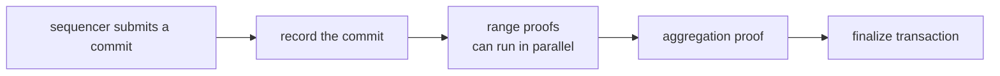
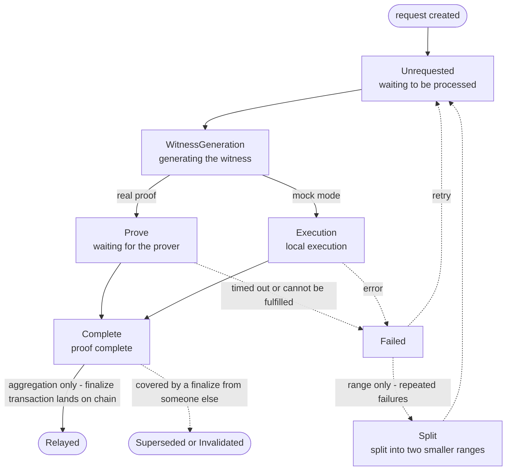

# Proposer design

The proposer is the off-chain service of the Metis validity bridge. It watches the data the sequencer commits to L1, generates validity proofs for that data,
and, when needed, submits a proof to L1 to complete finalization (finalize). Finalize is permissionless: anyone can run a proposer.

This document explains when it requests a range proof, when it requests an aggregation proof, and when it submits on chain.

---

## 1. Overall flow

1. The sequencer packs L2 transactions into blobs and calls `commitBatches` to commit them to L1.
2. The proposer records every commit.
3. The proposer cuts the committed data into several segments and generates one range proof per segment. The segments do not depend on each other and can run in parallel.
4. When a finalize is needed, it merges consecutive range proofs into one aggregation proof.
5. It submits the aggregation proof to `MetisRollup.finalize`. Once the contract has verified it, the withdrawals in that span of data can be claimed on L1.

## 2. Terms

| Term | Meaning |
| --- | --- |
| batch | The data in one blob, containing a number of consecutive L2 blocks. Each batch has an increasing index |
| commit | One `commitBatches` transaction from the sequencer, containing 1 to 6 batches |
| batch hash | The chained hash the contract stores for committed data: each blob's hash is chained onto the previous value in turn, and the L1 anchor is folded in at the end of each commit |
| commit boundary | The last batch of each commit. The contract stores the batch hash only at these positions |
| finalized | The latest position for which the contract has verified a proof |

The proposer works in units of commits. The start and end of both range proofs and aggregation proofs must fall on a commit boundary.

## 3. Lifecycle of a proof request

Range proofs and aggregation proofs go through the same set of states. They differ only in the conditions for creation, the handling of failures, and where they go after completion.
In the diagram, solid lines are the normal path and dashed lines are the failure or invalidation paths.

| | range proof | aggregation proof |
| --- | --- | --- |
| When it is created | A commit range not yet covered by a proof appears | The trigger condition is met, and range proofs contiguously cover up to the target |
| Start and end | Any commit boundary | The first segment starts at the contract's current finalized position; with segmentation, each later segment starts where the previous one ends. Every segment ends at a commit boundary |
| After a failure | The same range is retried; when it has failed more than 2 times or cannot be executed, it is split at a commit boundary into two smaller ranges | Created again |
| After completion | Waits to be used by an aggregation | The finalize transaction is sent; it becomes `Relayed` once on chain |
| Fully covered by someone else's finalize | `Superseded`, no longer used | `Superseded` |
| Cut through the middle by someone else's finalize | `Invalidated` | `Invalidated` |

- A range that contains only one commit cannot be split further. If it keeps failing, the proposer stops retrying and raises an alert; this usually means the execution result of the proof program disagrees with that of the Metis node.
- At any stage, if a commit the request depends on is reorged out on L1 or reverted by governance, the request becomes `Invalidated`.
- When the backlog of ranges exceeds the number that can be merged at once, the aggregation is divided into several segments, each starting where the previous one ends; see "When to finalize".

## 4. What each loop iteration does

The proposer runs one iteration at a fixed interval. An error in any step only ends the current iteration; it starts over later.

1. **Validate the configuration.** The local proof program version and rollup configuration must match what the contract has registered; otherwise the generated proofs will not be accepted.
2. **Sync L1.** Record new commit, finalize and revert events, and check whether any recorded commit has been reorged out on L1.
3. **Archive blobs (optional).** When archiving is configured, save the blobs of new commits.
4. **Record metrics.** For example, how far finalize lags behind and the number of requests in each state.
5. **Collect finished tasks.** Failed requests are retried or split here.
6. **Clean up leftover tasks.** Requests still shown as "in progress" after a process restart are marked as failed.
7. **Query the prover.** Fetch completed proofs, and handle requests that timed out or cannot be fulfilled.
8. **Reconcile.** Because Metis finalize is permissionless, check whether locally completed proofs have already been covered by someone else's finalize.
9. **Plan ranges.** Find the commit ranges not yet covered by a proof and create new range requests.
10. **Create aggregations.** When the trigger condition is met, group consecutive range proofs into one aggregation request; when there are too many ranges, divide them into several.
11. **Start one task.** Take one pending request, generate the witness and send it to the prover.
12. **Submit finalize.** If there is a completed aggregation proof, send the transaction.
13. **Refresh the instance lock.** This ensures that only one proposer instance per chain writes to the database.

## 5. When to finalize

Commits proceed continuously; finalize happens on demand: when no withdrawal is waiting, there is no need to spend L1 gas verifying a proof. The proposer finalizes only when either of the following conditions is met:

| Condition | Behavior |
| --- | --- |
| A request is received | Finalize up to the position the request specifies |
| No request for a long time | When the earliest unfinalized commit has waited longer than `SUBMISSION_INTERVAL`, finalize up to the latest proven position |

Requests are submitted through the proposer's `RequestFinalize` interface, which can be called by the withdrawal relayer, the operator or a user front end.

`SUBMISSION_INTERVAL` is a length of time, 7 days by default. Ethereum retains blobs for only about 18 days, so 7 days leaves about 11 days to complete the aggregation proof, submit it on chain and retry after failures. This way, even if there is never a withdrawal, every commit is finalized while its blob can still be fetched from L1, and unfinalized data does not accumulate without bound.

Range proofs are always generated continuously; only aggregation and on-chain submission are triggered by the conditions above. This way the wait for an on-demand finalize is only one aggregation proof plus one transaction.

### 5.1 Segmented finalization when the backlog is large

The longer the gap between two finalizes, the more range proofs have to be merged. The computation of an aggregation is proportional to the number of ranges; when there are too many, the proof is slow, or cannot be completed in one go at all. How the proposer deals with this:

1. **Limit the number merged at once** (`MAX_RANGES_PER_AGGREGATION`). When the limit is exceeded, cut the backlog into several segments, with one aggregation proof per segment. The segments do not depend on each other and can be proven in parallel, then finalized one by one in order. The contract's `finalize` can stop at any commit boundary, so the contract does not need to change. The cost is that every additional segment pays the L1 verification gas one more time.
2. **`SUBMISSION_INTERVAL`** limits how long the backlog can build up, so that segmentation is rarely needed under normal conditions.

**Segmentation has a second upper limit: the number of deposit-root syncs** (`MAX_DEPOSIT_SYNCS_PER_FINALIZE`).
During `finalize` the contract must do one storage read and one hash for every deposit-root sync on L2 within the range. Gas grows with the number of syncs, and too many will exceed the gas limit of a single transaction. The proposer counts the syncs in each commit and cuts a segment once the running total within a segment reaches the limit. Whichever of the two limits is reached first determines the cut.

A segment is at least one commit. When the number of syncs within a single commit already exceeds the limit, the proposer cannot cut any further and can only raise an alert; this case has to be avoided by having the L2 consensus layer limit the sync frequency.

## 6. Exceptional cases

| Case | How the proposer handles it |
| --- | --- |
| L1 reorgs out a commit | The record of that commit and the proofs that depend on it are invalidated; planning starts again from the commits on the new chain |
| Governance reverts a commit | That commit and everything after it are invalidated; they are proven again after the sequencer resubmits |
| Someone else completes a finalize first | The local aggregation is discarded. Range proofs already covered by the other party are no longer used; range proofs after the other party's end point remain usable |
| A proof fails | Retry; after repeated failures, split it into smaller ranges at a commit boundary and try again |
| The finalize transaction fails | Retry in the next iteration, unless reconciliation finds that it has already been covered by someone else |
| Upgrading the proof program | First finalize the whole backlog with the old program, then switch to the new program. Old range proofs that have not been finalized cannot be used after the switch; see section 4 of upgrade.md |
| A commit still has no proof after a long time and its blob is close to expiry | Alert. The suggested threshold is 14 days, which leaves about 4 days to handle it |

Someone else finalizing first does not lead to an incorrect state: the contract accepts only valid proofs, and the execution result of the same span of data is deterministic.

## 7. Configuration

| Variable | Meaning |
| --- | --- |
| `L1_RPC`, `L1_BEACON_RPC`, `L2_RPC`, `L2_NODE_RPC` | Node endpoints |
| `ROLLUP_CONTRACT`, `L1_BRIDGE`, `L2_BRIDGE` | Contract addresses |
| `L1_CONFIRMATIONS` | Number of L1 confirmations to wait for before processing a commit |
| `RANGE_PROOF_COMMITS`, `RANGE_PROOF_CYCLE_LIMIT` | Upper limits on the size of a single range |
| `SUBMISSION_INTERVAL` | 7 days by default. The longest an unfinalized commit waits when there is no request; must be shorter than the blob retention period |
| `MAX_RANGES_PER_AGGREGATION` | Maximum number of range proofs one aggregation merges; beyond it, finalization is segmented. Value to be measured |
| `MAX_DEPOSIT_SYNCS_PER_FINALIZE` | Maximum number of deposit-root syncs one finalize covers; beyond it, finalization is segmented. Value to be determined from measured `finalize` gas |
| `MAX_CONCURRENT_WITNESS_GEN`, `MAX_CONCURRENT_PROOF_REQUESTS` | Concurrency limits |
| `ZIREN_PROVER`, `AGG_PROOF_MODE` | Prover backend; aggregation proof format, `groth16`, `plonk` or `shrink` |
| `BLOB_ARCHIVE_PATH`, `BLOB_ARCHIVE_REMOTE` | Optional. Local blob archive directory; fallback source used when a blob cannot be fetched from the beacon node. When neither is configured, blobs are fetched only from the beacon node |
| `PRIVATE_KEY` or a signer endpoint | Sends the finalize transaction |
| `DATABASE_URL`, `LOOP_INTERVAL`, `METRICS_PORT` | Database, loop interval, metrics port |

