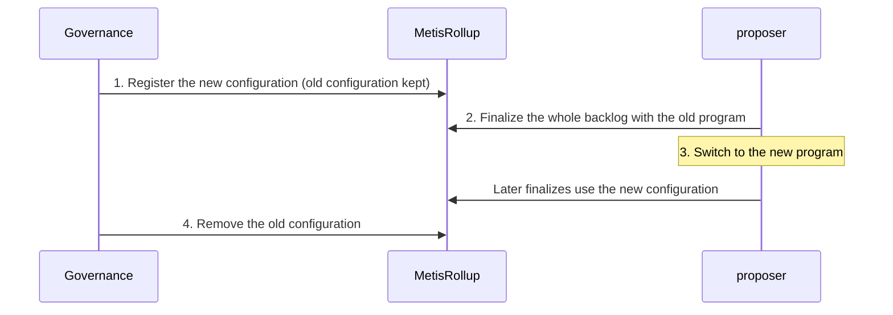

# Upgrades: proof programs and contracts

The validity bridge will keep changing after launch: Metis will hard fork, Ziren will release new versions, and the contracts will get bug fixes.

This document explains, for each kind of upgrade, what has to change, in what order, and how users are affected.

## 1. Three things to remember first

1. **Finalized data is never affected by an upgrade.** Its result is the output root stored by the contract, which does not depend on any old proof or old program.
   A withdrawal that can already be claimed can still be claimed after an upgrade.
2. **Only the "committed but not yet finalized" part is affected.** It is at most about 7 days (the proposer's longest finalize interval), the corresponding blobs are still on L1, and it can be re-proven at any time.
3. **Upgrades work by "add the new first, then remove the old".** The contract can register several configurations at the same time, and the Gateway can register several verification routes at the same time. Old and new coexist for a while, and finalize is not interrupted.

## 2. Components that can be upgraded

| Component | What it is | Where it is registered | Who changes it |
|---|---|---|---|
| range program | The proof program that replays L2 transactions | The configuration in `MetisRollup` | Governance |
| aggregation program | The proof program that merges range proofs | The configuration in `MetisRollup` | Governance |
| rollup configuration | Chain parameters, for example the activation height of each hard fork | The configuration in `MetisRollup` | Governance |
| Verifier circuit | The contract that verifies the final proof on L1 | The Gateway's routes | Governance |
| Contract code | `MetisRollup` and the two bridges | The implementation that the proxy contract points to | Governance |

One **configuration** is a combination of three values: the aggregation program's vk commitment, the range program's vk commitment, and the rollup config hash.

The contract only accepts a proof that exactly matches one of the registered configurations. The governance role should sit behind a timelock, and every change has a notice period.

## 3. Common upgrade scenarios

| Scenario | What to replace | Old proofs still unfinalized at the switch |
|---|---|---|
| Metis hard forks and the execution rules change | range program, rollup configuration | Invalidated |
| Only the aggregation program is fixed | aggregation program | Range proofs can still be used, unless the Ziren version also changed |
| Ziren upgrade | range program, aggregation program, possibly the verifier circuit too | Invalidated |
| Changing the proof format (between Groth16, Plonk and shrink) | Only add one route in the Gateway | Not affected |
| Fixing a contract bug or adding a feature | Contract code | Usually not affected, see below |

"Invalidated" applies only to old proofs that are still unfinalized when the proposer switches to the new program. Clearing the backlog first, in the order of section 4, leaves no such proofs.

Why old proofs are invalidated: when a program is recompiled its vk changes. Old proofs correspond to the old vk and do not match the new configuration.

If a Ziren upgrade changes the recursion circuit, the new aggregation program cannot verify range proofs produced by the old version either.

## 4. Upgrading the proof programs

This is the most common upgrade. Following the order below wastes none of the existing proofs:

1. **Register the new configuration.** The old configuration is kept, so both are valid at this point.
2. **Clear the backlog.** The proposer uses the old program to merge the existing range proofs and finalize up to the latest commit.
3. **Switch.** The proposer changes to the new program. Data after this point is proven with the new program.
4. **Remove the old configuration.** From this moment, proofs from the old program are no longer accepted.

Skipping step 2 does not break anything either. The unfinalized data just has to be re-proven with the new program, at most about 7 days' worth (the proposer's longest finalize interval). This can be done for an emergency fix.

**A hard fork needs the upgrade in advance.** The new range program understands the rules both before and after the fork, and switches at the activation height in the rollup configuration. It must be registered and enabled before the fork activates. Otherwise no program can prove the blocks after the fork, and finalize stops until the new program is live.

## 5. Upgrading the verifier circuit or proof format

Verification on L1 is not done by `MetisRollup` directly. It hands the proof to the Gateway, and the Gateway finds the matching verifier from the first 4 bytes of the proof.

- **Adding** a circuit or format: register a new route in the Gateway. Neither the configuration nor the code of `MetisRollup` needs to change, and the proposer switches by changing one configuration item.
- **Disabling** a circuit that has a problem: freeze its route. After the freeze, every proof that uses this circuit is rejected.
- A route cannot be overwritten or deleted, and a freeze cannot be undone. So both registering and freezing must be done with care and coordinated with the proposer's switch time, to avoid having no usable route after a freeze.

## 6. Upgrading the contract code

All three business contracts are deployed behind proxies: `MetisRollup` and `MetisL1Bridge` on L1, and `MetisL2Bridge` on L2. An upgrade replaces the implementation, and the address and storage stay the same.

- **What must not be touched.** The stored commit records, the finalize records, and the marks for withdrawals already claimed. The upgraded code must be able to read them exactly as they are.
- **When only the contract's internal logic changes**, the proof programs do not need to change, and unfinalized proofs stay valid.
- **When the proof's public values or the composition of the output root change**, the contract and the proof programs must be replaced together. The procedure is the same as upgrading the proof programs: first finalize the whole backlog with the old version, then upgrade the contract and register the new configuration in the same governance operation.
- An upgrade of `MetisL2Bridge` is an L2 transaction. It is part of the L2 state and is replayed by the range program as usual, so it needs no special handling. But if the way withdrawal records are stored changes, withdrawal verification on L1 must be upgraded at the same time.

## 7. Emergencies

| Situation | Handling |
|---|---|
| A vulnerability is found in a proof program | Remove the corresponding configuration and register the fixed configuration. Unfinalized data is re-proven with the new program |
| A vulnerability is found in a verifier circuit | Freeze the corresponding route and switch to another registered route |
| Committed data has a problem | Governance reverts the commits not yet finalized, and the sequencer commits again. Finalized ones cannot be reverted |

Removing a configuration and freezing a route only affect later finalizes. They do not change state that is already finalized.

## 8. Impact on users

- Finalized withdrawals: no impact.
- Withdrawals initiated during an upgrade: no extra wait when the upgrade follows the normal order. When "clear the backlog" is skipped, or in an emergency fix, they must wait for the new program to re-prove the unfinalized data. The waiting time depends on the size of the backlog and on proving capacity.
- Deposits: they do not go through proofs and are not affected by proof program upgrades.
